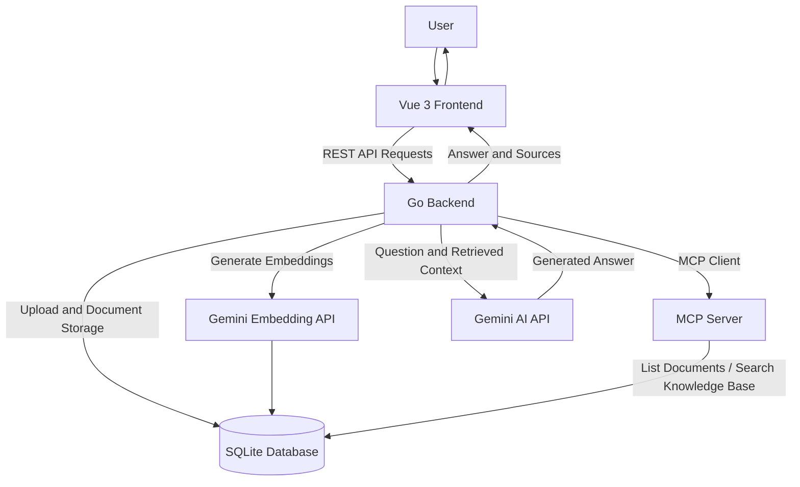

# AI Knowledge Assistant

## 1. Project Overview

AI Knowledge Assistant is a document-based question-answering application built using Go, Vue 3, SQLite, MCP, and Google's Gemini API.

Users can upload PDF and TXT documents and ask questions about their content. The application retrieves relevant document chunks and uses Gemini to generate answers grounded in the uploaded information.

## 2. Technologies Used

- **Backend:** Go
- **Frontend:** Vue 3, Vite
- **Database:** SQLite
- **AI Model:** Google Gemini API
- **Embeddings:** Gemini Embedding API
- **Protocol:** Model Context Protocol (MCP)
- **Document Processing:** PDF and TXT text extraction

## 3. Features

- Upload PDF and TXT documents.
- Store document information in SQLite.
- Extract text and divide documents into chunks.
- Generate and store document embeddings.
- Retrieve relevant chunks using cosine similarity.
- Generate document-grounded answers using Gemini.
- Display source references with answers.
- Delete uploaded documents.
- Maintain multiple chat sessions and save chat history.
- Expose knowledge-base tools through an MCP server.

## 4. Project Structure

```text
AI-Knowledge-Assistent/
│
├── main.go
├── mcp_server.go
├── mcp_client.go
├── go.mod
├── go.sum
├── .env.example
├── .gitignore
├── README.md
│
├── frontend/
│   ├── src/
│   │   └── App.vue
│   ├── package.json
│   └── vite.config.js
│
└── uploads/
```

The SQLite database file `knowledge.db` is created locally when the backend runs.

## 5. Prerequisites

Install the following:

- Go
- Node.js and npm
- Git
- Google Gemini API key
- GCC compiler for SQLite CGO support on Windows

## 6. Configuration

Create a `.env` file in the project root.

Add your Gemini API key:

```env
GEMINI_API_KEY=your_gemini_api_key_here
```

Never upload your actual `.env` file or API key to GitHub.

## 7. How to Run the Project

### Step 1: Start the Go backend

Open a terminal in the project root:

```powershell
go mod download
go run .
```

The backend runs at:

`http://localhost:8080`

### Step 2: Start the Vue frontend

Open another terminal:

```powershell
cd frontend
npm install
npm run dev
```

Open the frontend at:

`http://localhost:5173`

Keep both terminals running while using the application.

## 8. API Endpoints

| Method | Endpoint | Description |
|---|---|---|
| POST | `/api/documents/upload` | Upload a document |
| GET | `/api/documents` | List documents |
| DELETE | `/api/documents/{id}` | Delete a document |
| GET | `/api/documents/{id}/chunks` | Retrieve document chunks |
| POST | `/api/chat` | Ask questions |
| GET | `/api/chat/history/{id}` | Retrieve chat history |

## 9. MCP Tools

The MCP server exposes two tools:

- `list_documents` – Lists available documents.
- `search_knowledge_base` – Searches relevant document chunks.

The Go backend connects to the MCP server through an MCP client.

## 10. RAG Workflow

1. User uploads a PDF or TXT document.
2. Backend extracts its text.
3. Text is divided into smaller chunks.
4. Embeddings are generated and stored in SQLite.
5. User submits a question.
6. The question embedding is generated.
7. Relevant chunks are retrieved through MCP.
8. Retrieved context is sent to Gemini.
9. Gemini generates a grounded response.
10. The response and source references are returned to the frontend.


## 11. System Architecture




## 12. Technical Decisions and Limitations

- SQLite is used for persistent document and chat storage.
- Embeddings are stored as JSON vectors in SQLite.
- Similarity search uses cosine similarity over stored embeddings rather than a dedicated vector database such as Qdrant.
- The application uses a basic MVP implementation of document retrieval and MCP integration.
- A production deployment would benefit from a dedicated vector database, stronger authentication, and additional automated tests.

## 13. Future Improvements

- Integrate Qdrant or another dedicated vector database.
- Add authentication and user-level document isolation.
- Improve chat history management in the frontend.
- Add streaming AI responses.
- Add Docker deployment.
- Add automated backend and frontend tests.

## 14. Author

**Utkarsh Narendra Raut**

AI Knowledge Assistant – Technical Assessment Project
